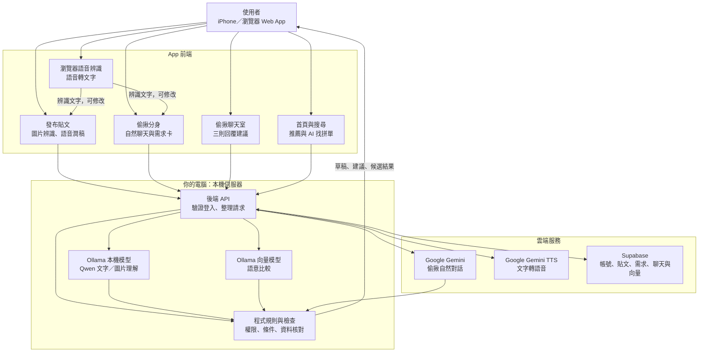
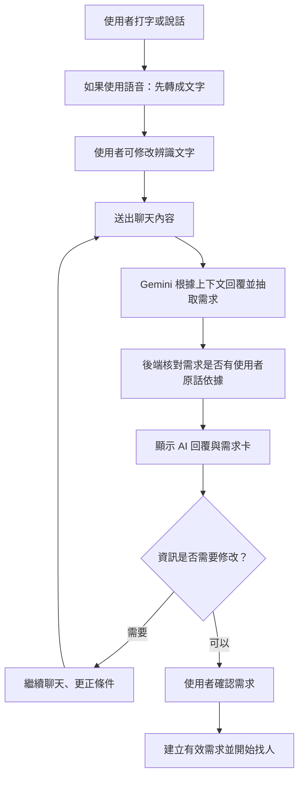
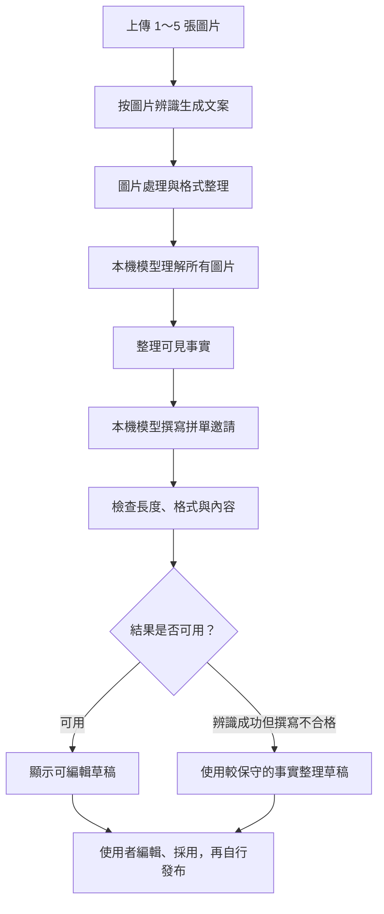
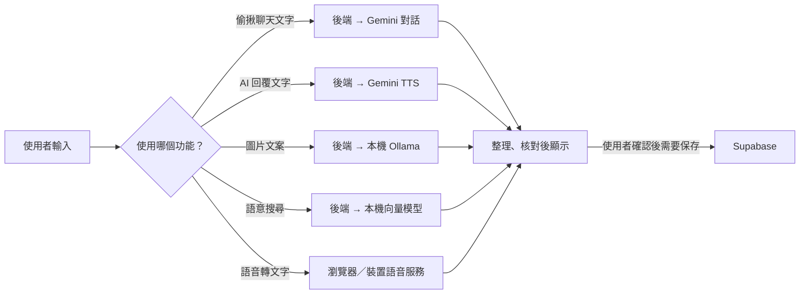

# 政缺一咖：AI 功能與架構說明

> 整理日期：2026 年 11 月。本文依當時的程式碼與本機能力狀態整理，適合專案成員閱讀；模型、功能設定或部署方式變更後應重新核對。

目前 App 的 AI 並非由單一模型包辦，而是由**雲端 Gemini、本機 Ollama 模型、語音辨識服務，以及資料庫規則**共同完成。

- **Gemini** 主要負責偷揪的自然對話與語音回覆。
- **本機 Qwen 模型**主要負責圖片理解、文案撰寫、語意向量和部分聊天室建議。
- **資料庫規則**負責檢查條件、篩選配對、保存資料與確認權限。
- **使用者本人**仍決定是否發布、參加、傳送訊息或確認拼單。

整理時，本機 AI 功能設定為 `ollama_local`，語意功能已開啟；Ollama 模型清單中有 `qwen3.5:4b` 和 `qwen3-embedding:0.6b`。偷揪 Gemini 模型名稱依程式設定及先前接線紀錄說明；本次沒有使用真實帳號、呼叫 Gemini 或查看金鑰來重新驗證雲端額度。

---

## 一、整體 AI 架構



可以把它想成一間餐廳：

- **前端**是服務生，負責接收你的話和呈現結果。
- **後端 API**像櫃檯，先確認是誰提出需求，再交給對應的工作人員。
- **Gemini**像擅長對話的接待員。
- **本機 Qwen**像在你的電腦上工作的文案與圖片理解助手。
- **向量模型**像幫文字做「意思索引」的分類員。
- **資料庫規則**像檢查訂單條件的管理系統。
- **使用者**是最後做決定的人。

你的電腦目前同時承擔本機伺服器及本機模型工作，因此它的運行狀態會直接影響 App 的 AI 功能。

---

## 二、目前有哪些 AI 功能？

| 功能 | 使用者從哪裡使用 | 主要工作 | 主要方式 |
|---|---|---|---|
| 偷揪自然聊天 | 偷揪頁 | 聽懂需求、追問、整理需求卡 | Gemini 對話＋程式核對 |
| 偷揪語音輸入 | 偷揪聊天輸入框 | 將說話轉成可修改文字 | 瀏覽器／裝置語音辨識 |
| 偷揪語音回覆 | 偷揪頁 | 將 AI 文字回覆念出來 | Gemini TTS |
| 圖片辨識生成文案 | 發布／編輯貼文 | 理解最多五張圖片並產生拼單邀請 | 本機多模態模型 |
| 語音潤稿 | 發布／編輯貼文 | 將口述需求整理成貼文 | 語音辨識＋本機文字模型 |
| 偷揪需求配對 | 確認偷揪需求後 | 找到條件可能相符的其他人 | 主要是資料庫規則；另有語意功能 |
| 偷揪聊天室回覆建議 | 偷揪配對聊天室 | 產生三則可修改的回覆 | 本機模型；失敗時使用規則建議 |
| AI 找拼單 | 搜尋頁 | 依輸入句子的意思調整貼文排序 | 本機向量模型＋推薦規則 |
| 首頁推薦 | 首頁 | 依偏好和貼文狀態排序 | 目前主要是明確規則評分 |

---

## 三、偷揪 AI：把聊天變成可配對的需求

這是目前最接近「AI 分身」的功能。它的目的不是單純陪使用者聊天，而是把使用者用自然語言說出的需求，整理成一張可以拿去尋找夥伴的需求卡。

例如：「我想吃麥當勞，但不想出宿舍，如果有人願意幫我買，我可以多付十元。」

系統要理解的內容包括：

- 目標：想吃麥當勞。
- 地點：希望留在宿舍附近。
- 分工：本人偏向等待，希望其他人協助購買或取餐。
- 額外費用：願意多付十元。
- 尚未知道：餐點預算、具體宿舍、可配合時間等。

這裡的「多付十元」不能直接解讀成「餐點預算十元」。程式有針對這類情況做額外檢查。

### 3.1 使用流程



1. 使用者輸入一句話，或點麥克風說話。
2. 如果使用語音，瀏覽器先將語音轉為文字。
3. 使用者可以修改辨識錯誤的文字，再送出。
4. 後端把這一輪及前面的對話交給 Gemini。
5. Gemini 同時產生給使用者看的自然回覆，以及從對話中抽出的結構化需求。
6. 後端檢查抽出的需求是否有使用者原話依據。
7. App 更新需求卡；使用者可以繼續聊天、更正，或確認開始找人。

程式位置：[偷揪對話處理](../app/core_cloud/conversation.py)、[Gemini 對話設定](../app/core_cloud/gemini_conversation.py)。

### 3.2 Gemini 在對話中做什麼？

目前程式接的是 `gemini-3.5-flash-lite`。Gemini 收到的主要內容包括使用者目前及前面的對話、AI 先前的回覆、可選的分身偏好，以及系統對它的要求。

例如：用繁體中文自然回覆；不要像填表一樣逐欄盤問；已回答過的事情不要一直重問；不確定內容不能自行當成事實；不可以假裝已配對、付款或下單；最新更正優先於舊內容。

Gemini 回傳的內容可以理解成兩部分：

```text
給使用者看的話：
「了解，你想留在宿舍，也願意多付一些跑腿費。你在哪一棟宿舍附近呢？」

機器可使用的需求資訊：
想做的事：買飲料
地點：尚未確認
本人是否取餐：不願意
額外費用：10 元
```

第二部分實際使用結構化資料格式，方便程式檢查和產生需求卡。

#### 它不是永久記憶

目前的「記憶」主要是本次對話歷史、前一輪已整理出的需求、使用者設定的分身偏好，以及在某些情況下可作為參考的最近相似需求。它不是像人一樣自動永久記住所有事情，也不是把所有聊天拿去重新訓練專屬模型。

### 3.3 使用者改變心意時

例如先按了「我願意取餐」，後來又說「我其實不願意取餐」，後端會依對話順序檢查使用者對分工的表態：

```text
前一句：我願意取餐
        ↓
後一句：我其實不願意取餐
        ↓
以後一句為準，移除「願意取餐」
```

同時保留沒有被更改的預算、時間和地點。AI 的文字回答之外，程式還會重新核對使用者最新的意思。不過自然語言仍可能有模糊或辨識錯誤，需求卡仍需要本人確認。

### 3.4 需求卡與有效時間

需求卡可能包含需求標題、類型、地點、可接受時間、預算、願意或不願意負責的事情，以及建立時間。

| 來源 | 例子 | 是否直接當作已確認 |
|---|---|---|
| 使用者明確說出 | 「預算最多 200 元」 | 先核對原話，再納入需求 |
| 使用者按選項 | 「我願意下單」 | 可納入，但後續更正可以覆蓋 |
| 偏好或系統推測 | 平常常在某地取餐 | 可作為建議，不能冒充這次已明確同意 |

例如使用者說「今天整天都可以」，系統會嘗試解讀成今天剩餘時間內可配合，而不是固定給兩小時。若使用者未提供某些資訊，程式仍可能依歷史需求或預設值產生待確認條件；按下確認前仍應看一次需求卡。

目前快速偷揪建立的需求預設有效期限是**建立後 24 小時**，使用者也可以提前停止。要區分：

- **需求有效期**：這張需求持續供系統找人的期限。
- **可接受時段**：使用者實際方便見面、購買或取餐的時間範圍。

例如晚上六點建立的需求可有效 24 小時，但本人只有明天中午方便取餐；兩者可以不同。

---

## 四、偷揪語音：聽懂使用者，以及讓 AI 說話

### 4.1 使用者說話：語音辨識

```text
你對手機說話 → 瀏覽器／裝置的語音辨識服務 → 產生文字
→ 你先檢查、修改 → 按送出 → 文字進入偷揪聊天
```

Web App 使用瀏覽器的語音辨識介面，語言設定為繁體中文 `zh-TW`。辨識品質受瀏覽器、裝置、網路與環境音影響；這不等於 Gemini 直接聽取聲音。瀏覽器服務是否需要連網及資料如何處理依其服務而定。辨識文字可先修改，避免錯誤直接影響需求。

程式位置：[瀏覽器語音辨識](../../nccu-grouping-app/src/lib/post-speech.web.ts)。

### 4.2 AI 說話：文字轉語音

目前程式中的語音模型為 `gemini-3.8-flash-lite-tts`：Gemini 先產生回覆文字，後端再將文字交給 Gemini TTS 產生語音資料，最後由手機播放。

- 語音辨識：**聲音 → 文字**。
- TTS：**文字 → 聲音**。

程式提供串流語音處理，目標是分段送回音訊，降低文字已出來但聲音等待太久的感受。仍可能因生成文字、合成語音、網路傳輸或 iPhone 自動播放限制產生延遲；這不是完全無延遲的即時語音通話。

---

## 五、偷揪配對：AI 會怎麼找到其他人？

偷揪配對分兩層：AI 協助把聊天整理成結構化需求，資料庫條件規則再檢查是否能配對。Gemini 理解了「想喝飲料」，不代表它有權直接把任何人拉進聊天室。

### 5.1 可能影響配對的條件

- 需求是否仍有效、仍為啟用狀態。
- 是否為不同使用者，以及使用者之間是否互相封鎖。
- 需求類型、餐點或類別是否相容。
- 地點是否符合配對規則，可接受時間是否有交集。
- 已知費用是否超過預算，已提供金額是否互相衝突。
- 特定飲食需求是否已有必要確認，品牌是否明確衝突。
- 是否有人提供優惠、願意取餐或協助其他分工。

例如 A 想喝五十嵐、在自強十舍附近、下午 3 點到 5 點方便；B 也想買五十嵐、在同一地點、下午 4 點到 6 點方便。兩人時間在下午 4 點到 5 點有交集，品牌、類型、地點也相近，因此較有機會成為候選配對。

反之，若 A 只能在自強十舍取餐、B 只願意在政大正門取餐，就可能不會配對。

**目前限制：**地點可自由輸入，不等於系統已能理解所有地名之間的距離。配對條件仍有依地點欄位做一致性檢查的邏輯，因此「自強十舍」與「自強 10 舍」等不同寫法是否合併取決於需求理解結果，不能保證所有別名都會合併。未來可以加入地點標準化或距離判斷。

### 5.2 配對分數

程式有規則分數，依共同偏好、需求類型、可提供資源、分工和人數等條件加分。例如有共同偏好、有人願意提供優惠券、有人明確表示可順路取餐，或需求與資源可以互補。

這是**條件排序分數**，不是成團機率、對某人的信譽評價，也不是 AI 對結果正確性的保證。

### 5.3 找到候選人後

```text
建立需求 → 產生可能合適的候選 → 各人決定是否願意聊
→ 符合聊天室開啟條件後進入協調 → 討論品項、價格、時間、地點與分工
→ 如要形成正式拼單，仍需確認相關條件
```

「願意聊」與「同意購買、付款、下單」是不同事情。配對與聊天室安全檢查由 Supabase／後端規則執行，包含帳號、需求狀態、封鎖與權限。

---

## 六、偷揪的語意搜尋與向量

專案也有**語意搜尋配對機會**的能力，本機向量模型為 `qwen3-embedding:0.6b`。

「向量」可理解成把一句話轉成一組代表意思的數字。例如「我想找人一起買飲料」與「有人要一起訂手搖嗎」用字不同，但意思接近，向量模型可以比較它們的相似程度。

```text
已確認的偷揪需求 → 整理文字摘要 → 本機向量模型轉成數字
→ 將向量與需求版本存入資料庫 → 搜尋符合權限與條件的其他需求
→ 找出可能有語意關聯的候選 → 再套用實際配對與安全檢查
```

資料庫仍會重新檢查需求是否有效、使用者是否有權操作、需求版本是否變更，以及配對和封鎖限制是否成立。**語意相近只是尋找線索，不代表一定能成團。**

程式位置：[偷揪語意搜尋](../app/core_cloud/discovery.py)。

### 需要注意的現況

專案有「AI 搜尋新配對機會」及對既有候選進行語意分析的程式，但屬於特定入口或明確操作的能力。不應說每個需求都一定持續由 AI 自動搜尋全站；較準確的說法是：系統有規則式配對流程，也具備本機語意搜尋與候選分析能力，實際是否執行取決於入口與功能設定。

---

## 七、偷揪聊天室：三則回覆建議

例如對方說：「我可以去買，但我不確定你想喝哪一款。」系統可能提供：

1. 「可以先看看有哪些品項適用優惠嗎？」
2. 「我還沒決定口味，我們先確認活動內容好了。」
3. 「謝謝你願意幫忙買，我們也先討論一下取餐時間。」

使用者可選一則放進輸入框，再修改並自行按傳送。

### 7.1 建議的依據

後端取得使用者有權查看的配對需求摘要、地點、預算、已知費用、自己的分工、未確認事項、最近最多 20 則聊天室訊息，以及上一批建議和批次資訊。模型被要求優先回應最新對方訊息、分清楚誰說了什麼、不把對方的承諾寫成自己的承諾、不憑空編造價格或安排，並產生三則不同的繁體中文建議。

### 7.2 為什麼有時比較制式？

- **本機模型正常產生：**依配對內容與最新對話產生候選句子，介面可顯示「AI 回覆建議」。
- **模型忙碌、失敗或結果不合格：**改用預先準備的安全協調問句，例如「取餐地點和時間怎麼安排比較方便？」介面會提示目前提供一般協調問句。

所以有三則建議，不代表每次都由模型即時生成。「監看聊天室」更精確的描述是：App 在聊天室開啟期間定期取得新訊息，內容變動後重新請求建議；不是 AI 在背景永久讀取所有聊天。

程式位置：[回覆建議邏輯](../app/core_cloud/reply_suggestions.py)、[建議介面](../../nccu-grouping-app/src/components/stealth-reply-suggestions.tsx)。

---

## 八、發布貼文：圖片辨識生成文案

使用者不必輸入文字，只上傳照片，就可讓 AI 嘗試理解照片並撰寫拼單邀請。最多可使用五張照片，包括買一送一宣傳單、菜單、食物、飲料、商品、品牌標誌或其他可辨識圖片。



系統分兩個階段：先理解圖片中可見的品牌、商品、食物、價格、優惠、日期、限制及不同圖片之間的關係；再根據辨識結果撰寫邀請別人拼單的文案，而不是只描述圖片背景。

例如圖片寫「買一送一」，系統不能自行推論所有商品都適用或每人固定多少錢。草稿要求至少約 **50 個非空白字元**，並限制在貼文可接受長度範圍內。

生成後不會自動發布。使用者仍需閱讀、修改，核對價格、時間與地點，再按發布。

如果圖片無法辨識，系統會提示；若模型產生的事實、格式或長度不合格，會嘗試修正。若辨識事實可使用但撰寫不合格，可能退回較保守的事實整理草稿，讓使用者自行確認。

程式位置：[圖片辨識與文案產生](../app/core_cloud/post_writing.py)。

---

## 九、發布貼文：語音潤稿

使用者可以直接說：「我想吃一堆麥當勞薯條，有人要一起吃嗎？」系統先將聲音辨識成文字，再由本機模型整理成較完整的拼單邀請。

```text
按「語音潤稿」→ 允許麥克風與語音辨識 → 自然說出需求
→ 瀏覽器將聲音轉成文字 → 使用者檢查、修改辨識文字
→ 後端交給本機模型潤稿 → 顯示至少約 50 字的草稿
→ 使用者修改並決定是否採用
```

潤稿不應憑空加入使用者沒有說過的價格、數量或承諾。例如只說想吃薯條，AI 不應自行寫「每人 80 元，晚上六點在宿舍集合」。

若本機模型結果無法通過檢查，程式會嘗試保留使用者原話，搭配較中性的拼單邀請模板，避免口述內容全部丟失。

---

## 十、首頁推薦：目前主要是規則，不是大型語言模型

一般首頁推薦根據使用者偏好及貼文狀態，主要使用明確規則評分，例如貼文標籤、地點名稱是否符合偏好、剩餘名額、截止時間，以及封鎖、隱藏、取消、截止或額滿狀態。

例如偏好是「飲料、自強十舍」，一篇標籤為「飲料」、地點為「自強十舍」的貼文，可能因符合兩項偏好獲得較高分數。

已操作過的貼文，例如自己主揪、已申請、已加入或其他已有關聯的狀態，依前端排序會放在尚未操作的貼文後面。

手動下拉重整時，前端會在相近分數的貼文群組內輪替，因此相近內容可能前後交換；不是完全隨機，也不是無視推薦分數洗牌。

程式位置：[首頁排序](../../nccu-grouping-app/src/lib/feed-ordering.ts)。

---

## 十一、搜尋頁「AI 找拼單」：用意思排序

使用者可輸入一句需求，例如「想找晚上可以在宿舍附近一起買飲料的人」。系統不只找文字完全相同的貼文，也試著理解語意：搜尋「想一起買手搖」時，「有人要一起訂飲料嗎？」即使用字不同，意思仍可能接近。

```text
輸入需求 → 資料庫提供可見、可參加的候選貼文
→ 本機向量模型分別轉換搜尋句與候選貼文 → 計算語意相似程度
→ 結合既有推薦規則分數 → 再次檢查貼文仍可見、仍可參加 → 排序顯示
```

### 它是排序還是過濾？

**主要是排序。**但 AI 排序前會先排除已取消、截止、額滿、封鎖作者、手動隱藏或目前帳號無權查看的內容。精確地說：先用規則篩掉不可見或不可參加的內容，再用 AI 語意與推薦分數排序剩下的候選。

程式設定每次語意搜尋最多 **64 篇候選貼文**；資料多時，結果不一定等於對整個資料庫所有貼文逐篇做 AI 比對。

目前綜合分數概念大致為：

```text
既有推薦規則分數 × 0.4 + 語意相似度 × 60
```

分數愈高排序愈前，但這只是排序參考，不是 AI 對貼文品質的保證。

程式位置：[AI 找拼單排序](../app/core_cloud/feed_semantic.py)。

---

## 十二、本機模型與雲端模型如何分工？

| 功能 | 執行位置 | 主要用途 | 是否依賴雲端 AI |
|---|---|---|---|
| 偷揪自然對話 | Google Gemini | 對話、釐清需求 | 是 |
| 偷揪語音回覆 | Google Gemini TTS | 把文字變成聲音 | 是 |
| 圖片辨識與文案 | 使用者電腦上的 Ollama | 圖片理解、文案生成 | 目前設計為本機模型 |
| 語音潤稿的文字生成 | 使用者電腦上的 Ollama | 整理口述文字 | 目前設計為本機模型 |
| 搜尋語意向量 | 使用者電腦上的 Ollama | 文字意思比較 | 目前設計為本機模型 |
| 偷揪聊天室建議 | 使用者電腦上的 Ollama | 產生建議回覆 | 本機；失敗有規則備援 |
| 語音辨識 | 手機瀏覽器／裝置服務 | 聲音轉文字 | 依瀏覽器服務而定 |
| 配對資料與權限 | Supabase | 保存資料、規則檢查 | 需要雲端資料庫 |

整理時，這台電腦模型清單包含：

```text
qwen3.5:4b
qwen3-embedding:0.6b
```

`qwen3.5:4b` 偏向理解、生成與整理內容；`qwen3-embedding:0.6b` 偏向把文字轉成向量以比較語意。模型已安裝不代表每次請求都一定成功，仍受伺服器、模型服務、電腦負載及設定影響。

---

## 十三、為什麼多人一起用時 AI 可能變慢？

這台電腦同時提供 Web App、執行後端 API、處理圖片與文案、執行語意向量模型，以及接收並轉送多位使用者請求。若三到五人同時上傳多張照片、辨識文案、使用 AI 找拼單、刷新聊天建議或持續聊天，就會競爭處理器、記憶體與模型運算資源。

### 13.1 文案排隊機制

圖片辨識與語音潤稿使用工作佇列：第一個人開始處理，之後的請求排隊。系統可回報排隊中、執行中、完成、失敗或取消。

目前文案工作由**單一工作者依序處理**，多人同時操作時等待可能明顯增加；每位使用者也不能無限制重複排入多個文案工作。這可減少模型被大量同時請求壓垮，但代價是需要排隊。

### 13.2 Gemini 限制

Gemini 有兩類不同限制：Google 服務本身的額度與速率限制，以及 App 自行設定的請求節流與同時處理限制。免費方案不代表無限制使用，也不代表多人同時操作都不會等待。

整理時沒有登入 Google 後台查即時剩餘額度，不能從程式直接推算剩餘次數。

---

## 十四、AI 在哪裡可能出錯？

| 環節 | 可能問題 | 目前處理方式 |
|---|---|---|
| 語音辨識 | 把「五十嵐」聽成其他字 | 送出前允許修改 |
| 圖片辨識 | 看錯價格、活動日期或限制 | 提醒核對原圖；不得憑空推算 |
| 偷揪聊天 | 誤解誰願意下單、取餐 | 後端核對原話與最新更正 |
| 需求卡 | 地點、預算或時間整理錯誤 | 使用者確認前可繼續修改 |
| 配對 | 類似地點寫法不同，沒被匹配 | 目前仍受欄位與規則限制 |
| 回覆建議 | 句子不符合語境或變制式 | 可換一批、修改，或自行輸入 |
| 搜尋排序 | 文字相似，但實際不適合 | 仍需本人看貼文細節 |
| TTS | 聲音延遲或播放失敗 | 文字仍可閱讀，語音可重試 |
| 本機模型 | 忙碌、逾時或服務未啟動 | 排隊、提示失敗或使用部分備援 |
| 雲端模型 | Google 額度或網路問題 | 顯示錯誤，不能假裝成功 |

實際價格、優惠是否適用、過敏原、誰付款／下單／取餐、是否正式加入及是否完成交易，都需要使用者與其他參與者自行確認。

---

## 十五、資料與隱私：資訊會到哪裡？



- **偷揪聊天：**使用 Gemini 時，相關文字經由後端送到 Google Gemini 以理解上下文。
- **偷揪語音回覆：**AI 回覆文字送到 Gemini TTS 轉成音訊。
- **貼文圖片辨識：**程式設計將圖片交給這台電腦的本機 Ollama 模型；但圖片若發布成貼文，仍依上傳流程存放於雲端儲存服務。本機 AI 處理不代表發布後只存在電腦或手機。
- **語音辨識：**Web App 使用瀏覽器／裝置功能，不能直接假設聲音一定完全離線。
- **偷揪需求與向量：**確認後的需求存入 Supabase；執行語意搜尋時，需求語意向量也可能存入資料庫供符合權限的搜尋使用。向量雖不是容易閱讀的原句，仍應視為需要保護的個人需求資料。

---

## 十六、哪些是 AI，哪些是一般程式規則？

| 工作 | 目前主要方式 | 白話說明 |
|---|---|---|
| 理解「我想喝飲料」 | Gemini 或本機模型 | 嘗試理解自然語言 |
| 把需求整理成欄位 | AI＋程式檢查 | AI 提議欄位，程式再核對 |
| 判斷價格是否超過預算 | 規則 | 數字比較 |
| 判斷配對時間是否重疊 | 規則 | 檢查時間區間 |
| 判斷是否互相封鎖 | 規則與資料庫權限 | 檢查雙方是否被禁止互動 |
| 找意思相近的貼文 | 向量模型 | 比較文字語意 |
| 首頁一般推薦 | 規則 | 根據標籤、地點、名額等加分 |
| 產生貼文草稿 | 本機模型＋檢查 | 產生內容後檢查長度與事實 |
| 聊天建議 | 本機模型或固定建議 | 正常時依對話產生；失敗時備援 |
| AI 回覆朗讀 | Gemini TTS | 文字轉音訊 |
| 最後是否發布、加入或傳送 | 使用者 | 由本人決定 |

對外可說：「政缺一咖結合自然語言理解、圖片辨識、語音與語意搜尋，協助使用者建立拼單需求、尋找可能合適的夥伴，並在協調過程中提供回覆建議。」

不建議說「AI 會自動幫使用者完成訂購、付款，或保證配對成功」：目前實作沒有做到。

---

## 十七、目前架構的優點與限制

### 優點

1. **不必先學會填很多欄位：**可先打字或說話，再由系統整理條件。
2. **AI 與實際操作分開：**AI 提供建議，不會自行替使用者發布、付款或承諾取餐。
3. **本機與雲端混合：**對話與自然語音使用雲端模型；部分圖片、文字與向量工作由自己的電腦執行。
4. **有基本備援：**聊天室建議有固定問句備援，文案也有較保守草稿處理。
5. **有事實核對：**預算、費用及分工等資料不只依賴模型輸出，後端也檢查原話與最新更正。

### 限制

1. **依賴電腦開機：**本機模型、API 或服務停止後，相關功能無法正常使用。
2. **本機運算有限：**多人同時辨識圖片、搜尋或生成文案時，可能排隊或逾時。
3. **Gemini 受網路與額度影響：**額度用完、網路異常或服務繁忙可能影響偷揪對話及語音。
4. **地點相近不一定自動判斷：**自由輸入地點仍受欄位一致性限制。
5. **AI 可能理解錯誤：**圖片看錯、語音聽錯、誤解分工或錯判語意都可能發生，仍需確認。
6. **搜尋不是無限制全站逐篇推論：**AI 找拼單有候選數量上限，規模變大後可能需要更完整的索引和效能設計。

---

## 十八、給組員使用的簡短說明

> 我們的 App 把 AI 分成幾個部分。使用者在偷揪時，可以用打字或語音描述需求，Gemini 會根據對話幫忙釐清，系統再整理成需求卡；本人確認後才開始配對。
>
> 在發布貼文時，使用者可以上傳照片，讓本機 AI 辨識商品或優惠並產生拼單文案，也可以把口述內容整理成貼文。
>
> 搜尋方面，系統除了原本的偏好和條件排序，也能比較使用者輸入與貼文的語意，讓用字不同但意思接近的內容更容易被找到。偷揪聊天室則可提供三則可修改的回覆建議，幫助雙方確認價格、地點和分工。
>
> AI 提供理解、整理與建議；實際發布、參加、傳訊、付款和取餐仍由使用者自行決定。
