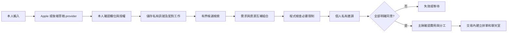

# 偷揪 agent 與配對設計

> 本文件描述原本完整地端原型。後續 Supabase adapter 已接到 App，包含分身、需求、配對、免費費用／分工草案、最終條件逐人確認與交易內正式成團；雲端封鎖管理仍待整合。當前可操作範圍、資料表與測試步驟見 [Supabase 開發說明](CORE_SUPABASE_DEV.md)。原型與原契約繼續保留。

## agent 的可執行邊界

agent = 使用者偏好＋當下生活訊號＋授權＋候選規劃器。外觀與名稱不影響權限，模型口吻不影響限制。首次預設停用，需要使用者明確開啟。

手機端 Apple 模型抽取欄位／補問是後續設計，尚未接入；使用者確認後才建立訊號。後端統一執行結構驗證、時間／預算／角色約束、配額與權限；目前草案由免費規則規劃器產生。

## 第一版已實作的角色與決策

- need：本人有需求，一席，不代替朋友報名。
- offer：本人願意提供資源；角色 coupon / share / order / pickup 等，仍需確認資源有效性。
- plan：本人明確願意順路 pickup；只填「經過」不代表授權幫忙。
- 至少一筆 need。只有 offer＋plan 不會被模型編造成需求。
- 本人確認的分類選項有交集、固定地點一致、非空時間交集、已知單人成本不超出任一已提供預算；必要飲食資訊未知就不配。
- 最多三個不同使用者；同一人的多個訊號不能占多席。
- 候選先排除停用、安靜時段、封鎖與無效訊號，再按相容分類／地點／時間各取至多 60 筆。
- 排序分數為啟發式（共同標籤、角色互補、參與人數），不是成團機率，也沒有訓練學習效果。
- fingerprint 記錄訊號與 agent 的 policy_version。名字、外觀代號與語氣只更新一般 version，不撤銷既有同意；停用／改變探索政策則更新 policy_version 並撤銷舊提案。

已支援明確的替代分類，例如 meal 需求可以本人確認 acceptable_categories=[pizza,bakery]，與特定 pizza 資源形成方案。後端不自行假設「晚餐」必然接受披薩，offer 也不能用替代分類捏造自己擁有的資源。尚未驗證真實模型從「飯／便當／晚餐」抽取這些選項的效果；需要模型評估，不能替規則配對貼上 LLM 標籤。

邀請文案依本人 tone（direct/warm/playful）呈現，why_me 只解釋本人的條件與貢獻；其他人的原文／身份／拒絕原因不回傳。拒絕可選 not_now/time/budget/food/privacy/other，只保存本人可見的 enum，單次拒絕不會自動重寫長期偏好。失效與已成立的方案有明確文案，避免仍顯示為可加入的新邀請。

## 三層 provider 策略

| 層 | 當前 | 下一階段 |
| --- | --- | --- |
| 欄位抽取 | OfflineDraftProvider，回傳 is_llm=false | Apple on-device，必要時限額 OpenAI，輸出同一 schema |
| 候選語意 | 手動確認分類／標籤 | 每筆訊號變更時計算一次 embedding；檢索後仍走硬限制 |
| 提案解釋 | 從驗證結果產生固定理由 | LLM 只整理驗證過的 facts/unknowns，不得新增價格、商家或承諾 |

即使模型不可用，結構化輸入、配對、同意與成團仍可完成。生產 provider 必須加入 timeout、有限重試、輸出驗證、內容最小化與成本紀錄；不可從模型輸出執行 SQL、shell、任意 URL 或更動授權。

本機可選 OllamaDraftProvider 已實作，預設停用，只有 MockTransport 測試，尚未在真實模型上評估。固定 loopback、已安裝本機模型檢查、無工具／redirect／環境 proxy、輸出限制與安全錯誤碼；沒有自動安裝或雲端備援。不能據此聲稱已有模型效果成果。

未來每次模型請求只取得該任務必要資料：不包含姓名、email、完整路線、私人聊天全文或 token。支援 tool calling 時，只允許明確列出的唯讀工具；「加入／付款／公開身份」永遠走本人確認的 API。

## PostgreSQL 交易接續設計

`app/stealth/postgres.py` 已有候選 SQL、row→domain 轉換、成團前鎖定與重驗證 building blocks；未接 HTTP 路由。SQL 編譯測試不代表正式 DB 整合通過。

正式成團交易需要：

1. 查驗操作者是 proposal member；對外不存在與無權限都回 404。
2. 依統一順序鎖 proposal、agents、signals。若一次需要多個同類 row，按 UUID 排序；agent 更新／撤銷／封鎖也必須遵守相同鎖策略。
3. 重驗證所有人 accepted、opt-in、版本、時效、封鎖與訊號可用性。
4. 鎖住的 agent rows 用於序列化日配額／封鎖／授權變更；不能只鎖不存在的 event row。
5. 建立既有 Post、accepted JoinRequest（主揪不申請自己）、Conversation、ConversationMember、StealthFormation；唯一約束保護重送。
6. 消耗訊號並寫通知／工作 outbox，全部一起 commit。外部 AI／推播不放交易內。
7. 退出拼單需獨立業務交易；不自動復活舊訊號，以免又被揪到使用者不想參加的事情。

同一 proposal 重送、兩 proposal 搶同一訊號、封鎖與成團同時發生、取消與接受同時發生，需在本機 PostgreSQL 做實際並發測試後才可切換正式 adapter。

## 評估集規劃

固定合成資料、固定 now，不使用真實使用者資料。至少建立：

| 分組 | 案例 | 驗收 |
| --- | --- | --- |
| 共同需求 | 兩人同時想吃披薩 | 可配，且共同條件正確 |
| 三方互補 | 想分食＋優惠券＋順路取餐 | 可配，且角色來源有授權 |
| 無需求 | 優惠券＋經過商店 | 不自動捏造需求 |
| 時間衝突 | 區間剛好碰到但無交集 | 拒絕 |
| 預算衝突 | 150 元上限，已知 151 元 | 拒絕；0 元不視為空值 |
| 資訊未知 | 價格未知／優惠未知 | 明列未知，不生成已省下金額 |
| 飲食限制 | 必要限制沒有來源聲明 | 拒絕，不以模型猜安全 |
| 權限 | 停用、封鎖、他人的訊號 | 不邀請／不洩漏 |
| 撤銷與競態 | 全員接受後撤銷或兩團同時成立 | 只允許仍有效且未使用的訊號 |
| 候選壅塞 | 70 筆無關新訊號＋1 筆相容舊訊號 | 相容者不被截斷掩蓋 |
| 語意泛化（待模型） | 晚餐需求＋便當資源，原文不共享詞 | 與關鍵字／固定分類 baseline 比較 |

目前 pytest 已驗證前十類規則與交易情境，尚未驗證最後一類真實模型泛化。不能把這些測試換算成真實成團率或模型準確率。

競賽應展示並量測：硬限制違反率、提案理由事實一致性、互補案例召回、用戶接受／拒絕原因、延遲、每次成本。真實接受率與使用時間須另做知情的使用者測試。

## 資料保留策略（規格，尚未排程清理）

- 短期訊號過期立即失去配對資格；不等背景清理才停止邀請。
- 原始文字只供本人；後端正式版本可選擇根本不保存未確認草稿。
- 建議過期／撤銷七天後清除非必要原文，保留最小角色／同意證據以維持提案紀錄一致；具體期限需產品確認。
- 不可直接硬刪訊號導致 proposal member 外鍵或本機 my_roles 查詢失效；採 tombstone／去識別化 migration，先 dry-run 報告再操作。
- token、API key、完整 prompt 不進 event 表或一般 log。
- 帳號刪除、已成立拼單保留需求與檢舉證據需另訂策略；此時只有合成資料，未擅自設定正式法務保留期限。

## 五小時後續工作優先級

1. 審查本機 SQLite adapter 與 PostgreSQL building blocks 的資料契約是否一致。
2. 為 pending jobs 加 next_attempt 與失效清理規則，防止重試飢餓；不啟動無限迴圈。
3. 檢查 local auth 對來源、路徑、停用環境的 fail-closed 行為。
4. 匯出 API 契約，驗證規格與 response schema 一致。
5. 更新可重現測試紀錄與未完成清單；不重複跑無新變更的測試，不以等待湊滿工時。
